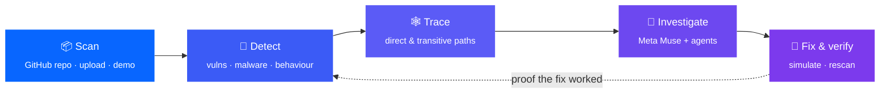
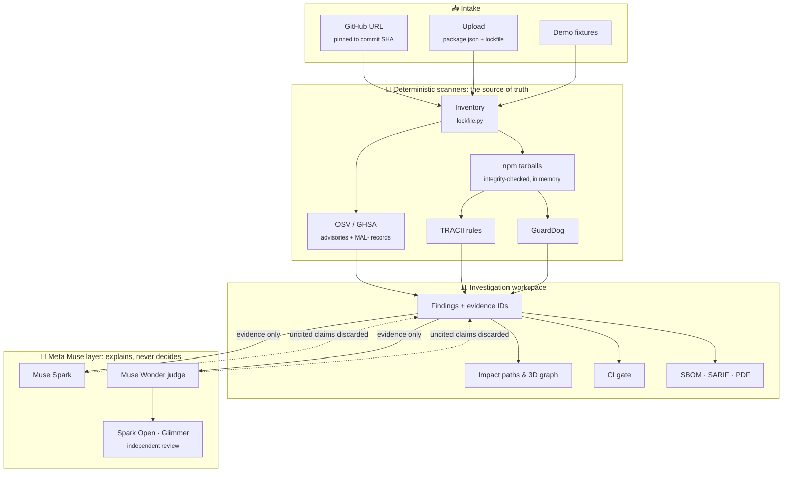
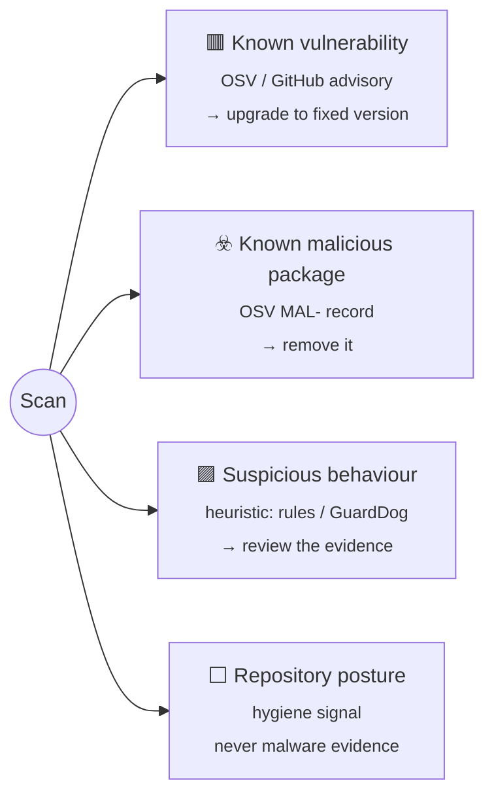
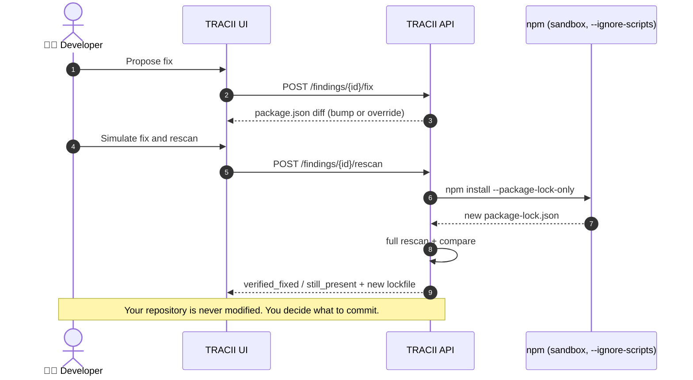
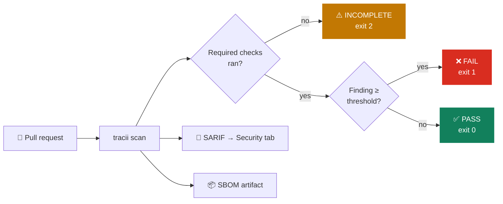

LIVE DEMO LINK : [DEMO](https://tracii-api.onrender.com/).

<div align="center">

# 🛡️ TRACII

### AI-native application & software supply-chain security intelligence

**Traditional tools list vulnerable packages. TRACII investigates them:** the path each one takes into your app,
the evidence behind it, what to change, and a rescan that proves the fix worked.


**[✨ Features](#-features)** · **[🚀 Quick start](#-quick-start)** · **[🧭 How it works](#-how-it-works)** · **[🚦 CI gate](#-ci-gate-sarif-sbom--pdf)** · **[📊 Evaluation](#-evaluation-malicious-package-detection)** · **[☁️ Deploy](#%EF%B8%8F-deploy)**

</div>

---

## 💡 Why TRACII?

A typical JavaScript app pulls in hundreds or thousands of packages, and most of them were never chosen by you: they
arrive **transitively**. Attackers know this. Compromised maintainers (`event-stream`, `ua-parser-js`), sabotage
(`colors`, `node-ipc`) and abandoned infrastructure (`fsevents`) have all shipped malicious code through packages
that looked trustworthy.

TRACII reads a project's `package.json` + `package-lock.json`, checks the **exact installed versions** against OSV
advisories, runs malicious-behaviour checks (GuardDog + TRACII's attack-chain rules) on prioritised packages **without
installing them**, traces how each flagged package reaches your app, explains findings with **evidence-cited Meta Muse
models**, and verifies a proposed fix by re-resolving the lockfile and rescanning.



## ✨ Features

| | Capability | What you get |
|---|---|---|
| 🧩 | **Software Composition Analysis** | Every lockfile entry (v1/v2/v3) matched to OSV / GitHub advisories on the exact installed version, with fixed versions |
| ☣️ | **Known-malware detection** | OSV `MAL-` records reported as **known malicious packages**, never mixed up with vulnerabilities |
| 🧪 | **Behaviour analysis** | TRACII attack-chain rules + GuardDog on prioritised tarballs, read in memory, **never installed or run** |
| 🕸️ | **3D dependency graph** | *Your* project: colour = scanner result, size = how many of your packages depend on it. Click a node to light up its path to your app |
| 🎬 | **Attack replays** | Four real npm incidents (event-stream, ua-parser-js, colors, node-ipc), every step sourced. Runs on your real path, or as a clearly labelled simulation |
| 🤖 | **AI investigation** | Muse Spark explains, Muse Wonder digs deeper, methodology agents (SSVC + EPSS + KEV, MITRE ATT&CK, SLSA + Scorecard, STRIDE) run in parallel; Spark Open and Glimmer review independently |
| 🔧 | **Verified remediation** | Proposed `package.json` change → lockfile re-resolved in a sandbox (`--ignore-scripts`) → rescan → `verified_fixed` only if the finding is really gone |
| 🔀 | **Version diff** | Security-relevant changes between two releases: install scripts, new hosts, capabilities, dependencies |
| 🚦 | **CI security gate** | GitHub Action + CLI with exit codes **0 / 1 / 2**; the same policy shown live in the UI |
| 📤 | **Exports** | CycloneDX 1.5 SBOM (with licences), SARIF 2.1.0, gate report, paginated **PDF assessment** |
| 📚 | **Guidebook** | A two-minute in-app guide to the workflow, terminology and limitations for first-time users |

## 🧭 How it works



### 🗂️ Four finding types, never merged into one score



### 🔁 Fix and verify loop



## 🚀 Quick start

> Works in GitHub Codespaces or locally (Python 3.12+, Node/npm for fix simulation).

```bash
bash scripts/setup_dev.sh          # venv, deps, osv-scanner binary, GuardDog (docker image, or its own venv without Docker), .env from template
# optional: put META_API_KEY, a Baseten key (Spark Open) and an NVIDIA key (Glimmer) in .env; see .env.example. Never commit it.
bash scripts/dev.sh                # API + UI on http://localhost:8000 (Codespaces: open forwarded port 8000)
```

### 🎯 Try it in two minutes

1. **Demo project → Scan demo** (`vulnerable-demo`): the verdict banner shows the CI gate result and what to look at first.
2. Open a finding → read the evidence and impact path → **Explain with evidence** (Muse Spark).
3. **Propose fix → Simulate fix and rescan** → watch it turn `verified_fixed`.
4. **GitHub repo → [OWASP/NodeGoat](https://github.com/OWASP/NodeGoat)** → a real known-malicious package (`fsevents@1.2.9`, `MAL-2023-462`); click **Focus highest-priority finding** under the graph.
5. **Play replay** under the 3D graph, then **Run investigation agents** on a finding (40–70 s with live models).
6. Export **SBOM · SARIF · CI gate report · PDF report**. Scan `clean-demo` to see a clean PASS.

### 🧪 Tests and checks

```bash
cd backend && ../.venv/bin/python -m pytest -q          # offline test suite
.venv/bin/python scripts/evaluate.py --guarddog         # detector check on labelled fixtures → results/
.venv/bin/python scripts/check_models.py                # live probe of each configured model → results/model_checks.json
# measured model status and latencies: docs/MODELS.md
```

## 🤖 Meta AI models

> [!NOTE]
> **Scanners decide; models explain.** Each model only sees the scanner's evidence and must cite evidence IDs.
> Without credentials every AI feature falls back to a deterministic summary. A model shows as *connected* only after a
> real call succeeds (**Model intelligence → Run live check**).

| Model | Role in TRACII |
|---|---|
| 🧠 **Muse Spark** | Evidence-grounded explanation of each finding, scan Q&A, the four methodology agents |
| 🔬 **Muse Wonder** | Deep investigation of a selected finding; judge that reconciles the agents |
| 🎙️ **Muse Voice Transcribe** | Hold-to-ask voice questions about a scan |
| 🖼️ **SAM 3.1** | Segments uploaded visual incident evidence (API) |
| 🤝 **Muse Spark Open** · **Muse Glimmer** | Independent second opinions on the same evidence, shown as agree / disagree |
| 🎨 **Muse Image** | Optional illustration only (off by default, never evidence) |
| 💻 **Muse Code** | Development-time coding agent, not a runtime model |

Details, endpoints and measured latencies: [docs/MODELS.md](docs/MODELS.md).

## 🚦 CI gate, SARIF, SBOM & PDF

Add TRACII to any repo with a `package-lock.json`:

```yaml
# .github/workflows/tracii.yml
on: [pull_request, push]
permissions: { contents: read, security-events: write }   # security-events: SARIF upload
jobs:
  tracii:
    runs-on: ubuntu-latest
    steps:
      - uses: actions/checkout@v4
      - uses: RaghavAror/TRACII_teamMOM_project@main
        with:
          fail-on: high              # critical | high | medium | low | none
          mode: enforce              # observe = report only, never fail the job
          sbom-file: sbom.cdx.json   # optional CycloneDX 1.5 SBOM
```



The job writes a markdown report to the run summary, uploads SARIF to the **Security → Code scanning** tab
(each finding points at its entry in `package-lock.json`), and exits **0** pass · **1** blocking findings ·
**2** incomplete scan (OSV or the inventory could not run, so "no findings" would not mean anything). Unknown severities are
listed, never silently gated; use `fail-on-unknown: true` to gate them. All inputs: [action.yml](action.yml).

Same thing locally or in any other CI:

```bash
cd backend
../.venv/bin/python -m tracii scan --dir ../my-app --fail-on high --sarif tracii.sarif --sbom sbom.cdx.json
../.venv/bin/python -m tracii sbom --dir ../my-app -o sbom.cdx.json      # SBOM only: offline, no scan
```

In the web UI, every finished scan shows the **live gate decision** (same policy code, adjustable threshold) and has
**Export: SBOM · SARIF · CI gate report · PDF report**:

| Export | Endpoint | Contents |
|---|---|---|
| 📦 SBOM | `GET /api/scans/{id}/sbom` | CycloneDX 1.5: one component per name@version with purl, the SHA-512 from the lockfile, scope (devDependencies are `excluded`), licence and the resolved dependency graph. Only OSV advisories go into `vulnerabilities`; malicious-behaviour signals are detector output, not advisories, so they stay out of it |
| 📄 SARIF | `GET /api/scans/{id}/sarif` | SARIF 2.1.0 for GitHub code scanning |
| 🚦 Gate | `GET /api/scans/{id}/gate` | Outcome, exit code, blocking / non-blocking findings, markdown report |
| 📑 PDF | `GET /api/scans/{id}/report.pdf?fail_on=high` | Paginated assessment built from that scan's stored result (ReportLab): summary, coverage, prioritised findings, paths, gate, limitations, full appendix. AI sections appear only for AI calls that succeeded on that scan |

## 📊 Evaluation (malicious-package detection)

Measured on labelled npm packages: malware from [DataDog's malicious-software-packages-dataset](https://github.com/DataDog/malicious-software-packages-dataset)
(Apache-2.0, commit `3fc8a1f`), benign packages from the npm registry. Started from the chainviz-v2 dataset
(345 packages). Nothing is trained: the detectors are hand-written rules plus the OSV lookup. Each score below
comes from data **locked before that round of rule changes and run once**. "Flagged" means a malicious-behaviour finding with severity
medium or higher.

| Held-out set (run once) | Rules | Malware caught: code rules | + OSV known-malware list | False alarms (benign) |
|---|---|---|---|---|
| chainviz test split (33 malware / 105 benign) | round 1 | 19/33 (58%) | 31/33 (94%) | 3/105 (2.9%) |
| fresh set 1 (58 / 100) | round 2 | 36/58 (62%) | 52/58 (90%) | 5/100 (5.0%) |
| **fresh set 2 (60 / 98), current rules** | **round 3** | **37/60 (62%)**, 66% of samples that contain code | **53/60 (88%)** | **2/98 (2.0%)** |

On fresh set 2: 0/40 false alarms on popular packages, 0/20 on older (2023–24) releases of popular packages, 0/18 on
packages with install scripts. The OSV list itself raised no false alarms on any benign package.

The same figures are available as structured data at `GET /api/benchmark` (`backend/tracii/eval/benchmark.json`); a test checks they match this table.

> [!TIP]
> **How to read it**
> - **New malware:** the code rules (about 60%) are the relevant number. **Known malware:** the OSV list adds most
>   of the rest. It only knows what has already been reported, and these samples were all reported, which flatters it.
> - Sample sizes are small. The 95% ranges are about ±12 points for detection and 1–7% for false alarms. Don't quote decimals.
> - Some "malicious" samples have no code to analyse: a bare `package.json` or a `console.log` placeholder,
>   labelled for who published them. They count as misses. The table gives the rate on samples that contain code separately.
> - Most remaining misses run their payload when the package is loaded rather than at install time. Recent
>   false alarms come from the data-theft rule (`vitest`, `ssh2`, an SDK that sends its own API key to its API).
> - Labels are DataDog's and were not independently verified. Benign packages skew newer than the malware.
>   Packages over 25 MB were skipped. GuardDog was not run on the malware, because it needs an on-disk copy.

<details>
<summary><b>🔍 What the rules check</b> (<a href="backend/tracii/detect/static_rules.py">static_rules.py</a>), as text, without running anything</summary>

- Install commands that carry the payload: `curl … $(whoami)`, inline `node -e`.
- Install-time files that use the network or child processes. These are lowered for native-addon builds
  (`binding.gyp`) and known download hosts, and raised for raw IPs and capture services such as `*.oastify.com` or
  `webhook.site`.
- Data-theft chains: system info, secrets or sensitive files sent over the network.
- Shell commands passed to `child_process`, and code that runs `npm publish`.
- javascript-obfuscator-style code.
- Large bundles (over 1 MB), read when an install script runs them.

OSV `MAL-` records are reported as **known malicious packages** (critical, "remove it"), not as vulnerabilities.
</details>

<details>
<summary><b>♻️ Reproduce</b></summary>

> [!CAUTION]
> Malware is downloaded as DataDog's encrypted zips and only ever read in memory. Never extract, install or run the
> samples, and keep `datasets/` out of git.

```bash
.venv/bin/python scripts/fetch_datadog_samples.py --labels datasets/chainviz-dataset/labels.csv --ref 3fc8a1ff23fadb612234526e31a60e24bbc0bb3e
.venv/bin/python scripts/evaluate_dataset.py --labels datasets/chainviz-dataset/labels.csv --malicious-root datasets/cache/datadog --osv
.venv/bin/python scripts/build_fresh_testset.py --existing <labels.csv …> --dd-paths … --dd-manifest … --out datasets/fresh3/labels.csv --seed <new>
```

The holdouts above are used up. Measure the next round of rule changes on a new set built with a new seed, and
run it only after the rules are frozen (`--split … --final`).
</details>

## 🔐 Safety rules the code enforces

| | Rule |
|---|---|
| 🚫 | Never runs package lifecycle scripts; packages are read as data, never installed or executed |
| ✅ | Verifies tarball integrity and rejects links, path traversal and oversized archives |
| 🧱 | Keeps vulnerability and malware categories separate; no merged "risk score" |
| 🔗 | Every AI claim must cite an evidence ID or it is discarded; AI never changes the scanner verdict |
| 📝 | Package text is treated as data, not instructions |
| 🛠️ | Fixes are proposed, never applied to your repo; "verified" only after a real rescan or model call |
| 🌐 | Fix simulation refuses URL / git / `file:` / `link:` specs, workspaces and lockfile entries outside registry.npmjs.org, so a crafted `package.json` cannot make the server fetch internal URLs or read local paths |
| 🔒 | GitHub intake only accepts `https://github.com/<owner>/<repo>` and fetches two files by commit SHA |
| ⏱️ | Per-client rate limit on POSTs and a bounded in-memory scan store on public servers |

## ☁️ Deploy

**One service, API + UI on the same origin (recommended):** `render.yaml` builds `backend/Dockerfile` (context = repo root)
with OSV-Scanner, GuardDog and npm, and serves `frontend/` from the API (`SERVE_FRONTEND=1`), so there is no CORS or API URL to set.

1. Render → **New → Blueprint** → this repo (or New → Web Service → Docker, Dockerfile path `backend/Dockerfile`, context `.`).
2. Environment: `META_API_KEY` (optional; without it every AI feature falls back to a deterministic summary), `GITHUB_TOKEN`
   (optional, read-only, raises the GitHub rate limit), optional `SPARK_OPEN_*` / `GLIMMER_*`. Leave `ALLOWED_ORIGINS` empty.
3. Open `https://<service>.onrender.com/api/health`, then the root URL. **Model intelligence → Run live check** sends one minimal
   request per configured model and shows connected / failed per model.

Same image anywhere:

```bash
docker build -f backend/Dockerfile -t tracii . && docker run -p 8000:8000 --env-file .env tracii
```

> [!WARNING]
> Free Render instances sleep when idle; open the URL a minute before a demo. Scans are kept in memory only and are lost on restart.

Split hosting is still supported: UI on Vercel (`vercel.json`, set `window.TRACII_API` in `frontend/config.js`), API with
`SERVE_FRONTEND=0` and `ALLOWED_ORIGINS=https://<your-ui>`.

Public-server limits: `RATE_LIMIT_PER_MIN` (POSTs per client IP, default 30), `MAX_STORED_SCANS` (in-memory history, default 100),
`DEEP_SCAN_LIMIT`.

## 🗺️ Project layout

```
backend/tracii/
  intake/      github.py (URL → commit SHA → manifest files), npm_registry.py (safe tarball fetch)
  inventory/   lockfile.py (v1/v2/v3, nested resolution, direct/dev/install-script flags, licences)
  detect/      osv.py (CLI | API), guarddog.py (Docker/offline), static_rules.py (attack chains)
  evidence/    schema.py (one Finding format), slicing.py (focused code slices)
  impact/      paths.py (shortest path per direct dependency, dev-only)
  diff/        version_diff.py (temporal security diff)
  ai/          meta_client.py, models.py (roles + honest status), grounding.py, investigator.py, threat_corpus.json
               agents.py (SSVC / ATT&CK / SLSA+Scorecard / STRIDE agents + judge), enrich.py (EPSS, KEV, npm provenance,
               Scorecard as citable evidence), ssvc_cisa.csv (official CISA table, pinned)
  replay/      scenarios.json (4 sourced incidents) + replay logic on the user's graph
  fix/         remediation.py (proposal → --package-lock-only --ignore-scripts → compare)
  export/      sarif.py (SARIF 2.1.0 for code scanning), sbom.py (CycloneDX 1.5 JSON), pdf_report.py (PDF assessment)
  eval/        dataset.py (labelled-dataset loader: npm tarballs + encrypted DataDog zips, read in memory), benchmark.json
  gate.py      CI pass/fail policy (enforce | observe, severity threshold, incomplete-scan rule) + markdown report
  cli.py       `python -m tracii scan | sbom` (used by action.yml)
  api/main.py  FastAPI routes (+ serves frontend/ in dev)
frontend/      static UI (no build step): app.js, graph3d.js (bundled 3d-force-graph + replays), agents-view.js
fixtures/      demo projects (vulnerable-demo, clean-demo; real lockfiles) + INERT malicious-like test packages
docs/          ARCHITECTURE.md · PLAN.md · MODELS.md · CHAINVIZ_AUDIT.md · MUSE_CODE_LOG.md
```

## 🙏 Credits

- Started from an audit of [drPod/chainviz](https://github.com/drPod/chainviz) (MIT). See `docs/CHAINVIZ_AUDIT.md` for what was kept.
- Uses [OSV-Scanner](https://github.com/google/osv-scanner) and [GuardDog](https://github.com/DataDog/guarddog) (both Apache-2.0).
- 3D view: [3d-force-graph](https://github.com/vasturiano/3d-force-graph) 1.80.1 (MIT), bundled in `frontend/vendor/` (licence alongside) so the demo does not depend on a CDN; jsDelivr is the fallback.
- PDF reports: [ReportLab](https://www.reportlab.com/opensource/) (BSD).
- SSVC decision table from [CERTCC/SSVC](https://github.com/CERTCC/SSVC) (`backend/tracii/ai/ssvc_cisa.csv` records the commit).
- Evaluation data: malicious samples from [DataDog/malicious-software-packages-dataset](https://github.com/DataDog/malicious-software-packages-dataset)
  (Apache-2.0), labels started from the chainviz-v2 dataset; benign packages keep their own licences.
- Threat intel: [FIRST EPSS](https://www.first.org/epss/), [CISA KEV](https://www.cisa.gov/known-exploited-vulnerabilities-catalog),
  [OpenSSF Scorecard](https://scorecard.dev), [MITRE ATT&CK](https://attack.mitre.org). None of these needs an API key.

<div align="center">

**Built for the Meta Global AI Developer Hackathon** · Released under the [MIT License](LICENSE)

</div>
