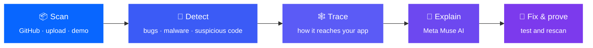

<div align="center">

# 🛡️ TRACII

### Find the risky code hiding inside your app, see how it got in, and fix it

**▶️ [Try the live demo](https://tracii-api.onrender.com/)** · built for the Meta Global AI Developer Hackathon


</div>

---

## 💡 The problem

Modern apps are mostly made of other people's code. A typical JavaScript app uses **hundreds or thousands of ready-made
packages**, and most of them were never chosen by the developer: they come along because another package needs them.

Attackers know this. Instead of breaking into your app, they slip bad code into one of those packages:

- **event-stream (2018):** a new maintainer added code that stole cryptocurrency wallets.
- **ua-parser-js (2021):** a hijacked package installed password stealers and crypto miners.
- **colors / node-ipc (2022):** their own authors sabotaged them.

Most security tools give you a long list of package names and codes. **They don't tell you how the problem reached your
app, whether it's real, or what to do first.**

## ✅ What TRACII does

You give TRACII a project (a GitHub link, two uploaded files, or a demo), and in about a minute it tells you, in plain words:

| | Question | TRACII's answer |
|---|---|---|
| 🔎 | **Is anything wrong?** | Known security bugs, packages already reported as malware, and code that behaves like malware |
| 🕸️ | **How did it get in?** | The exact chain of packages from your app to the risky one, on a map |
| 🧾 | **How do we know?** | The evidence behind every warning, with a link to the original report or the exact line of code |
| 🤖 | **What does it mean?** | Meta's Muse AI explains each problem in plain language, using only that evidence |
| 🔧 | **What should I do first?** | A short **fix plan**, e.g. *"3 upgrades fix 11 of 21 problems"* |
| ✔️ | **Did the fix work?** | TRACII tries the fix in a sealed test area and scans again, so you see proof before changing anything |



## 🎯 Try it in two minutes

1. Open the **[live demo](https://tracii-api.onrender.com/)** (if it is asleep, give it a minute to wake up), click **Scan demo**.
2. **Overview:** one headline, three counts and the fix plan.
3. **Findings:** one row per package, e.g. *"lodash · 5 vulnerabilities · upgrade to 4.18.0 fixes all"*. Open one and press **Explain with AI**.
4. **Propose fix → Simulate fix and rescan:** watch the problem disappear in the test run.
5. Scan the real project **[OWASP/NodeGoat](https://github.com/OWASP/NodeGoat)** from the GitHub tab: TRACII finds a package
   that is **known malware** (`fsevents 1.2.9`), buried four levels deep, and shows the path it took.
6. **Impact map → Explore in 3D**, and replay a real historical attack on your own project.
7. **Export** a PDF report for your manager, or the standard files security teams use (SBOM, SARIF).

New to security? Click **Guide** in the app: every term explained in one plain sentence.

## 🤖 How Meta AI is used

> **The scanners decide, the AI explains.** The AI only sees the evidence the scanners found and must point to it for
> every claim. Anything it can't back up is thrown away, and it can never change the verdict.

| Model | What it does in TRACII |
|---|---|
| **Muse Spark** | Explains each problem in plain language and answers your questions about the scan |
| **Muse Wonder** | Deeper investigation; leads a team of AI "specialists" that each look at a problem from a different angle |
| **Muse Spark Open · Muse Glimmer** | Independent second opinions, so you can see whether the AIs agree |
| **Muse Voice Transcribe** | Ask your question out loud |
| **SAM 3.1** | Finds the relevant parts of an uploaded screenshot used as evidence (available through the API) |
| **Muse Code** | Helped the team build TRACII (not used while the app runs) |

## 📊 How well does it work?

We tested TRACII's malware detection on packages we already knew were good or bad: real malware samples from a public
research collection, and normal packages from npm. Each test set was locked away before we changed our rules and used only once,
so the results are not "tuned to the test".

| Test set | TRACII's own checks catch | With the public malware list | False alarms on normal packages |
|---|---|---|---|
| First test (33 malware / 105 normal) | 19/33 (58%) | 31/33 (94%) | 3/105 (3%) |
| Second test (58 / 100) | 36/58 (62%) | 52/58 (90%) | 5/100 (5%) |
| **Latest test, current version (60 / 98)** | **37/60 (62%)** | **53/60 (88%)** | **2/98 (2%)** |

**In plain words:** TRACII's own checks catch about **6 in 10** malicious packages, *including brand-new ones nobody has reported yet*.
Adding the public list of already-reported malware brings that to about **9 in 10**. It wrongly flags about **2 in 100** normal packages in the latest test (3–5 in 100 in the earlier ones).
These are small test sets, so treat the numbers as rough ranges, not exact scores.

<details>
<summary>Method and caveats</summary>

Malware from [DataDog's malicious-software-packages-dataset](https://github.com/DataDog/malicious-software-packages-dataset)
(Apache-2.0, commit `3fc8a1f`), benign packages from the npm registry, starting from the chainviz-v2 dataset. Nothing is
trained: the detectors are hand-written rules plus the OSV lookup. "Flagged" means a malicious-behaviour finding of severity
medium or higher. 95% ranges are about ±12 points for detection and 1–7% for false alarms. Some "malicious" samples contain no
code at all and count as misses; labels are DataDog's and were not re-verified; GuardDog was not run on the malware. The same
figures are available at `GET /api/benchmark` (`backend/tracii/eval/benchmark.json`), and a test checks they match this table.
Malware samples are only ever read in memory, never unpacked, installed or run. Reproduce with `scripts/evaluate_dataset.py`.
</details>

## 🔐 Built to be trusted

- 🚫 **Never runs the code it checks.** Packages are read like documents, never installed or executed.
- 🧾 **Every warning has evidence** you can click through to the original source.
- 🧱 **Different problems are never blended into one score.** A known bug, known malware and a suspicious hint are shown separately.
- 🤖 **The AI can't overrule the facts.** Unsupported AI claims are discarded.
- 🛠️ **Your code is never changed.** Fixes are suggested and tested in a sandbox; you decide what to apply.
- ✋ **Honest about gaps.** A check that didn't run is shown as "not run", never as "passed". No warnings never means "guaranteed safe".

## 🧩 What's inside

**Checks:** public security reports (OSV / GitHub advisories), the public known-malware list, TRACII's own behaviour rules and
DataDog's GuardDog. **Views:** overview with fix plan, findings, impact map and 3D graph, attack replays, AI explanations,
AI specialists, version comparison and licence list. **Outputs:** PDF report, SBOM (CycloneDX), SARIF, and a CI security
gate that can automatically block a release when serious problems are found.

---

<details>
<summary><b>🛠️ For developers: run it locally</b></summary>

```bash
bash scripts/setup_dev.sh      # Python env, OSV-Scanner, GuardDog, .env from template
# optional: add META_API_KEY (and Spark Open / Glimmer keys) to .env, see .env.example. Never commit it.
bash scripts/dev.sh            # app on http://localhost:8000
cd backend && ../.venv/bin/python -m pytest -q    # tests
```
</details>

<details>
<summary><b>🚦 For developers: add the security gate to GitHub Actions</b></summary>

```yaml
# .github/workflows/tracii.yml
on: [pull_request, push]
permissions: { contents: read, security-events: write }
jobs:
  tracii:
    runs-on: ubuntu-latest
    steps:
      - uses: actions/checkout@v4
      - uses: RaghavAror/TRACII_teamMOM_project@main
        with:
          fail-on: high              # critical | high | medium | low | none
          mode: enforce              # observe = report only
          sbom-file: sbom.cdx.json
```

Exit codes: **0** pass · **1** blocking findings · **2** incomplete scan. Results appear in GitHub's Security tab.
Locally: `python -m tracii scan --dir my-app --fail-on high --sarif tracii.sarif --sbom sbom.cdx.json`. All inputs: [action.yml](action.yml).
</details>

<details>
<summary><b>☁️ For developers: deploy</b></summary>

One Docker service serves the app and the API (`render.yaml`, `backend/Dockerfile`). On Render: **New → Blueprint** → this repo,
then set `META_API_KEY`, `GITHUB_TOKEN` and optional `SPARK_OPEN_*` / `GLIMMER_*`. Anywhere else:
`docker build -f backend/Dockerfile -t tracii . && docker run -p 8000:8000 --env-file .env tracii`.
Limits for public servers: `RATE_LIMIT_PER_MIN`, `MAX_STORED_SCANS`, `DEEP_SCAN_LIMIT`. Scans live in memory; the browser keeps your last one.
</details>

<details>
<summary><b>🗺️ For developers: project layout</b></summary>

```
backend/tracii/   intake (GitHub, npm) · inventory (lockfiles) · detect (OSV, GuardDog, rules) · impact (paths)
                  ai (Meta Muse client, grounding, agents) · fix (proposal + sandbox rescan) · export (SARIF, SBOM, PDF)
                  replay (4 sourced incidents) · diff (version diff) · eval (benchmark) · gate.py · cli.py · api/main.py
frontend/         static UI, no build step (app.js, impact-map.js, graph3d.js + bundled 3d-force-graph)
fixtures/         demo projects (vulnerable-demo, clean-demo) + inert test packages
docs/             ARCHITECTURE · MODELS · PLAN · CHAINVIZ_AUDIT · MUSE_CODE_LOG
```
</details>

## 🙏 Credits

Built on [OSV-Scanner](https://github.com/google/osv-scanner) and [GuardDog](https://github.com/DataDog/guarddog) (Apache-2.0),
[3d-force-graph](https://github.com/vasturiano/3d-force-graph) (MIT), [ReportLab](https://www.reportlab.com/opensource/) (BSD),
[CERTCC/SSVC](https://github.com/CERTCC/SSVC), [FIRST EPSS](https://www.first.org/epss/),
[CISA KEV](https://www.cisa.gov/known-exploited-vulnerabilities-catalog), [OpenSSF Scorecard](https://scorecard.dev) and
[MITRE ATT&CK](https://attack.mitre.org). Started from an audit of [drPod/chainviz](https://github.com/drPod/chainviz) (MIT).
Evaluation data from [DataDog/malicious-software-packages-dataset](https://github.com/DataDog/malicious-software-packages-dataset).
Released under the [MIT License](LICENSE).
